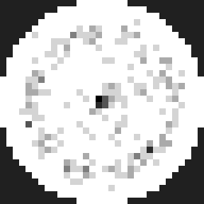
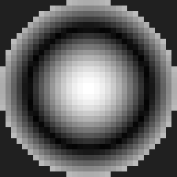

# M6-12 結果: 長時間砂運動と自然な模様形成の検証

PUT-IN: 物理は無変更（A=従来Hermite加速度が既定、B=ODE加速度は
研究用既定OFF）。秒単位の砂運動を測定し、分布変化の有無と原因を
切り分けた。測定は力学へ一切フィードバックしていない。
EMERGED: 現モデルで砂が大きく移動するのは、板加速度が重力を
大きく超える周波数だけだった。それ以外では初期配置が永久に
凍結する（モデルの性質として定量化）。模様は「描いて」いない。
claim-tier: measured（現モデル内）。実砂の再現では**ない**。
floors: 粒子間衝突なし・転がり摩擦なし（c_roll=0）・板への
反作用なし。この3つが下記の「凍結」の主因候補。

## 1. チェックポイント保存・復元（基盤）

- `checkpoint()`/`restore()`（TS）を実装。設計は
  `docs/m6_12_design.md` §1。
- 無中断実行との**ビット一致**を6テストで固定
  （`__tests__/checkpoint.test.ts`）。
- Python側には未実装（本段階の長時間実験はTSで実施）。

## 2. 長時間実験の条件

300粒・シード42・駆動力は全条件共通（`calibratedForceN()`）・
中心駆動・`step()` 駆動のみ。目標5秒、ステップ上限80,000
（到達時刻は周波数で異なる。下表）。再実行:
`PHYSI_BENCH=1 npx vitest run src/simulation/__tests__/study_m612.test.ts`

## 3. 何が起きたか（3つの振る舞いに分かれた）

板単独で測った「離脱余裕」= min(g + wtt)（全面×全時刻の最小値。
負ならどこかで着座粒が離脱し得る）が、全てを説明した:

| 周波数 | 到達時刻 | min(g+wtt) [m/s²] | 離脱回数(A) | 末期の分布 |
|---:|---:|---:|---:|---|
| 70Hz | 5.0s | **+8.83** | 0 | 初期配置のまま凍結 |
| 152Hz | 5.0s | −652.9 | 45,210 | 移動継続（下記） |
| 173.31Hz | 5.0s | −5.77 | 6,199 | 微小跳躍のみ、分布不変 |
| 271.3Hz | 5.0s | **+5.66** | 0 | 凍結 |
| 368.6Hz | 4.93s | **+5.32** | 0 | 凍結 |
| 500Hz | 3.64s | **+1.98** | 0 | 凍結 |
| 649Hz | 2.80s | −1918.2 | 66,819 | 激しく攪拌、未収束 |
| 1241.6Hz | 1.46s | −4.00 | 3,468 | 微小跳躍のみ、分布不変 |

### 凍結（70 / 271.3 / 368.6 / 500Hz）

板加速度が全面で重力を超えないため、着座した粒は二度と離脱
しない。現モデルは着座中の水平運動を持たない（転がりなし）
ため、初期落下で落ち着いた位置に永久に留まる。5秒後の分布は
初期散布そのもの（動径ヒストグラム完全一致、平均経路長1-2mm)。
**これは現モデルの予測であり、値を調整して「模様が出る」よう
にはしていない。** 実物の砂がこの条件でどうなるか（摩擦に
よるクリープ等）は現モデルの範囲外。

### 微小跳躍のみ（173.31 / 1241.6Hz）

離脱余裕が中心付近でわずかに負（−4〜−6 m/s²）。数千回の離脱・
数万回の衝突が起きるが、跳躍が小さく水平輸送がほぼ無い
（平均経路長 1.5-1.9cm/5秒、大半は鉛直。動径分布は不変）。

### 激しい運動（152 / 649Hz）

- 152Hz: 5秒で平均経路長0.48m。動径分布が初期の面積比例から
  r/a=0.6-0.8 の帯と中心へ寄り、分布エントロピーは
  5.46→5.00 へ低下（偏りが成長）。ただし5秒時点でも着座率は
  6%で大半は跳ね続けており、分布もまだ変化中（最後の2秒間で
  L1変化0.36)。「落ち着いた砂の線」ではなく、跳躍中の粒の
  滞在傾向として読むべきもの。約60粒は板外へ失われた。
- 649Hz: 攪拌が強く、2.8秒時点でも分布はほぼ一様
  （相関・偏りとも小さい)。

密度と活動度マップ（板単独の |wtt| 時間平均、砂には未入力）の
相関は152Hzで −0.21（A)、他はほぼ0。「弱振動域に集まる」と
断定できる段階ではない。画像: `docs/assets/m612/`
（density_* は最終密度、activity_* は活動度。中心駆動のため
活動度は同心円状で、暗い輪が加速度の小さい半径帯）。

粒子数を増やした追試（152Hz・1秒、1,000/5,000粒；649Hz・
1,000粒）では1秒時点の傾向は300粒と同質（まだ初期分布に近い）。

## 4. A（従来）vs B（ODE加速度）

- 長時間の統計（衝突/離脱回数、分布、エントロピー、相関）は
  全条件でほぼ一致（回数差は数%以内、カオス増幅の範囲）。
  凍結条件では分布まで完全一致。
- 速度はBが全条件で遅い（同セッション単回測定、300粒長時間で
  1.6〜9倍。着座粒が多い凍結条件で最悪: 500Hzで8.3倍。原因は
  着座粒ごとの区間離脱探索と休止証明の成功率低下）。
  1,000-5,000粒・1秒でも1.4〜2.2倍遅い。
- **判定: Bの本番採用根拠は依然として不足。** 板単独の解析解
  精度はBが上（M6-10/11）だが、砂の長時間統計で優位は観測
  できず、コストは明確に増える。既定OFFを維持する。

## 5. 候補C（五次Hermite）の安全条件

変位表現が変わるため既存の安全証明は引き継げない。その前提と
なる「区間内の変位・加速度の保守的範囲」を Bernstein 包含で
導出し、実駆動セグメント10,800件（3周波数×全自由度）で検証:

- 包含違反 0件（相対1e-9の丸め余裕込み、既存方式と同じ流儀）。
- 範囲の過大さ: 分割なしで真の幅の最大1.4倍、2段分割で
  1.02倍、4段で1.002倍。実用十分に tight。

砂へ接続する前に残る作業（未実施）: 高さ上限（hBound/セル
境界）、lookahead加速度範囲、離脱探索の各証明を五次表現で
書き直すこと。範囲部品の目処は立ったが、本段階では接続しない。
再実行: `study_m612c.test.ts`。

## 6. 性能（実測と推定の区別）

- 本実験の実測（Node単一スレッド）: 300粒・5秒級で2-11秒（A)。
  5,000粒・物理1秒（152Hz)は A=9.4秒 / B=21.1秒。
- 60万粒は M6-11 の実測（初期0.02秒に単一36秒）のまま。
  リアルタイムには約3桁遠い。今回その桁は変わっていない。
- 注記: 凍結条件では休止率100%近くまで上がり計算は速いが、
  それは「何も起きていない」ためであり性能の達成ではない。

## 7. 未解決・次の課題（優先順）

1. **着座中の水平輸送が無いことが最大のモデル限界。** 実砂の
   模様形成には、摩擦・転がり・粒子間相互作用が関与するはずで、
   現モデルでは Γ>1 の領域が広い条件でしか分布が動かない。
   次に物理を足すなら、見た目調整ではなくこの力学から。
2. 駆動力（振幅）依存性の走査: 凍結/活動の境界は駆動力で動く。
   本実験は較正済み固定力のみ。力の走査で境界を地図化できる。
3. 152Hz の分布が収束するかの長時間追跡（チェックポイントで
   分割実行可能になった）。
4. 候補Cの証明群の書き直しと研究用最小接続。
5. Python チェックポイント（本段階はTSのみ）。
6. 動径ビン不連続（約2.9µm、法線は滑らかな dR 標本）は従来
   通りの独立課題。
